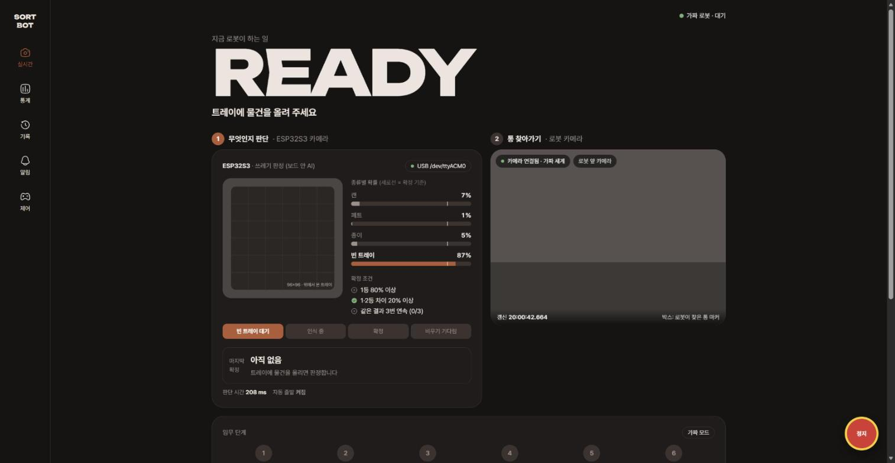
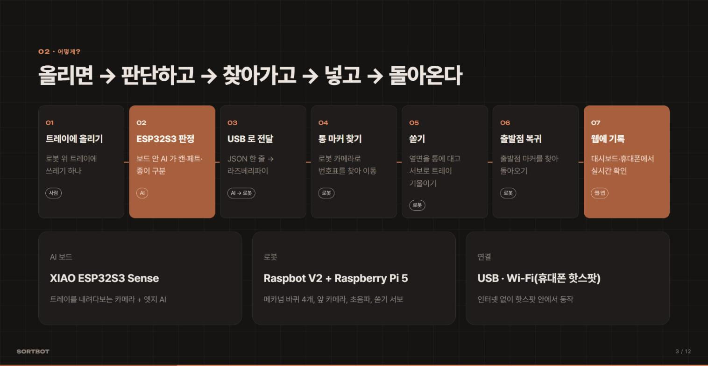

# Recycling Raspbot Project (SORTBOT)

> 쓰레기를 로봇 위 트레이에 올리면 **보드 안 AI** 가 캔 · 페트 · 종이를 판정하고, **로봇** 이 맞는 통까지 찾아가 쏟은 뒤 출발점으로 돌아온다. 모든 과정은 **웹 대시보드** 에서 실시간으로 보고 기록·제어한다.

- 3인 팀 프로젝트 · 2026.10 ~ 2026.11 · AI2 8조
- 발표 슬라이드: **https://sortbot-slides.vercel.app**
- 시연 영상: [로봇이 통 마커를 찾아가는 모습](slides/video/demo.mp4) · [대시보드 화면](slides/video/dashboard.mp4)
- 팀 저장소: https://github.com/jyj25/back-up — 이 저장소에는 대시보드와 발표 자료를 담았다



## 왜 만들었나

분리수거는 헷갈리고(라벨 붙은 페트는? 이건 캔인가?), 귀찮아서 결국 한 통에 섞여 버려진다. 사람이 하던 일을 셋으로 나눴다 — **판단은 AI, 옮기기는 로봇, 기록은 웹**.

## 어떻게 동작하나



```
XIAO ESP32S3 Sense ──USB JSON 한 줄──▶ Raspberry Pi 5 로봇 서버 ──HTTP API──▶ 웹 대시보드
 보드 안 AI 판정                         마커 찾아가기 · 쏟기 · 복귀            상태 · 판정 · 기록 · 제어
 {"class":"can","conf":0.93,"ms":173}
```

1. **판정 (엣지 AI)** — 트레이를 내려다보는 카메라 사진을 96×96 으로 줄여 **물체 검출(FOMO)** 로 캔 · 페트 · 종이 · 빈 트레이를 구분한다. 사진은 보드 밖으로 나가지 않아 인터넷 없이 빠르게 판단한다.
   - 잘못 출발하지 않도록 **확정 규칙**: 1등 확률 80% 이상 · 1·2등 차이 20% 이상 · 같은 결과 3번 연속일 때만 한 번 보내고, 트레이가 빌 때까지 기다린다.
2. **이동 (로봇)** — Raspbot V2 (메카넘 바퀴 4개, 앞 카메라, 초음파, 쏟기 서보). 통마다 붙인 **AprilTag 마커**(1 출발점 · 2 캔 · 3 페트 · 4 종이)를 찾아 **조금 가고 → 멈춰서 보고 → 다시 판단** 하는 방식으로 다가가, 옆면을 통에 대고 트레이를 기울여 쏟고 돌아온다.
3. **관제 (웹 · 앱)** — 로봇 서버 API 를 읽어 지금 로봇이 **무엇을, 왜** 하는지 보여 주는 대시보드. 휴대폰과 노트북에서 같은 화면을 쓴다.

## 대시보드 기능

| 기능 | 내용 |
| --- | --- |
| ESP32 판정 화면 | 트레이 그림 · 종류별 확률 막대 · 확정 조건 3개 · 보드 상태, 출발하지 않았다면 그 이유 |
| 로봇 카메라 | 실시간 영상, 찾은 통 마커에 박스, 연결 상태 |
| 임무 단계 | AI 판정 → 통 찾기 → 도착 → 쏟기 → 복귀 → 완료, 실패 · 취소는 이유와 함께 |
| 통계 · 기록 | 처리량 · 성공률 · 평균 시간, 통별 개수, 임무 기록과 도착 사진, CSV 내보내기 |
| 알림 | 연결 끊김, 장애물 정지, 카메라 · 보드 문제, 임무 실패, 통 가득 참 |
| 제어 | 정지, 임무 취소, 통으로 보내기, AI 자동 출발 켜기 · 끄기, 통 비우기 |

## 안전

- 로봇: 모든 이동 명령은 **최대 3초 뒤 자동 정지**(연결이 끊겨도 선다), 속도 상한, 앞 15cm 안 장애물 정지, 리모컨 비상 정지
- 웹: 보내기 전 **인터록**(연결 · 임무 중 아님 · 장애물 없음 · 통 여유, 서버도 다시 검사), 보내기 버튼은 **1초 누르고 있어야** 실행, 어느 화면에서나 정지 버튼

## 함께 일한 방식

- **인터페이스를 먼저 문서로 약속** — 판정 JSON, 로봇 API, 기록 API 형식을 정해 두고 각자 개발
- **가짜 상대로 먼저 시험** — 가짜 로봇 · 가짜 보드 시뮬레이터로 하드웨어 없이도 서로를 기다리지 않고 동시에 진행
- **GitHub 브랜치 → PR → 검토** — 각자 브랜치 · 폴더에서 작업하고 검토 후 합침

## AI 를 어떻게 활용했나

세 명 모두 **Claude Code**(Anthropic 의 코딩 AI, 터미널에서 코드를 읽고 쓰고 실행함)를 짝 프로그래머로 썼다. 로봇과 웹·앱은 Claude Opus, AI 판정 쪽은 Claude Sonnet 을 썼고, 팀 저장소의 커밋 107개 중 106개가 AI 와 함께 쓴 것으로 기록돼 있다 (`Co-Authored-By` 기록).

**나눈 방식** — 무엇을 만들지 정하기, 하드웨어 조립 · 실측 · 현장 시험, 최종 판단은 사람이 하고, AI 는 코드 · 문서 · 디버깅 · 반복 작업을 맡았다. 비밀값(와이파이 비밀번호, 로봇 IP 등)은 저장소에 올리지 않는다는 규칙을 AI 에게도 똑같이 지키게 했다.

### 라즈봇 (로봇)
- **조종 서버와 임무 로직** — 마커 찾기 → 가운데 맞추기 → 다가가기 → 도착 → 쏟기 → 복귀를 단계별로 구현하고, 사람이 잰 실측값(회전 시간, 쏟기 서보 각도 · 속도)을 받아 설정에 반영
- **가짜 로봇(시뮬레이터)과 자동 테스트** — 로봇 없이도 임무 흐름을 먼저 검증
- **실제 로봇에서 생긴 문제 디버깅** — 현상을 설명하면 원인을 찾아 고침
  - USB 웹캠을 카메라 라이브러리가 잘못 잡아 마커를 못 찾음 → OpenCV 로 열기
  - 쌓인 예전 화면으로 판단 → 최신 화면만 사용
  - 가까워지면 낮은 마커가 화면 아래로 빠져 사라짐 → 그 경우를 도착으로 판단
  - 서버 재시작 직후 카메라를 못 엶 → 다시 시도
- **안전 기능** — 이동 명령 3초 자동 정지, 리모컨 전원 버튼 비상 정지(와이파이가 끊겨도 멈춤)
- **문서** — 중간보고서, 요구 · 구조 · 인터페이스 · 결정 기록 같은 프로젝트 문서 묶음

### ESP32S3 (쓰레기 판정 AI)
- **데이터 수집기** — 보드가 직접 띄우는 수집 웹페이지, 이후 USB 케이블(Web Serial)로 바로 연결해 사진 수집
- **학습 자동화** — Edge Impulse 업로드 · 학습 · 평가를 명령 한 줄로 돌리는 스크립트(`train_ei.py`), 물체 박스를 자동으로 그리는 라벨링 스크립트(`autolabel.py`)
- **모델 방향 전환** — 분류 모델이 배경을 외우는 문제를 결과로 확인하고 물체 검출(FOMO)로 전환
- **브라우저 테스터** — 웹캠 · 보드 · 사진 파일로 모델을 시험하고 정답 기록과 혼동행렬을 보는 페이지
- **판정 펌웨어** — 확정 규칙(`sorter_logic.h`)과 시험, 여러 물체가 섞였을 때 대상을 고르는 로직, 보드 펌웨어 작성 후 컴파일 확인, 라즈베리파이에서 판정 JSON 을 읽는 확인 도구

### 웹 · 앱 (대시보드와 발표)
- **디자인 시안** — 참고 이미지 한 장을 주고 디자인 스킬로 시안 3개를 받아 하나를 고름 (다크 차콜 + 코퍼 톤)
- **기능 구현** — 필요한 기능 7가지(카메라, AI 결과, 로봇 상태, 통계, 기록, 알림, 수동 제어 + 인터록)를 글로 정리해 주면 화면으로 구현
- **연동** — 로봇 API 문서와 보드 펌웨어의 실제 출력 형식을 AI 가 직접 읽고 데이터 층을 맞춤. 로봇 서버를 가짜 모드로 켜고 판정 → 출발 → 기록까지 자동으로 시험
- **디버깅** — 확정 판정이 사라지는 문제, 팀원 PC 에서 실행 파일이 깨지는 문제(줄바꿈) 등을 원인부터 찾아 해결
- **화면 확인** — 브라우저 자동화로 화면을 띄워 캡처하며 글자 크기 · 배치 · 영상 재생을 점검
- **발표** — 웹 슬라이드 제작, 장별 대본 작성, Vercel 배포, 이 README 작성

### 느낀 점
- **약속 문서를 AI 와 먼저 쓰고, 각자의 AI 가 같은 문서를 읽고 구현**하니 세 부분이 처음 합칠 때 형식이 잘 맞았다.
- **가짜 모드 통과 ≠ 실제 동작** — AI 가 만든 코드는 시뮬레이터에서 잘 돌았지만, 실제 로봇에서는 카메라 · 거리 · 회전 문제가 새로 나왔다. 현장 시험과 실측은 사람이 해야 했다.
- **AI 결과도 검증한다** — 확인되지 않은 숫자는 발표 자료에서 뺐고, 화면은 직접 띄워 확인한 뒤에 올렸다.
- AI 덕분에 일주일 남짓한 기간(커밋 기록 10/28 ~ 11/3)에 로봇 서버 · 판정 펌웨어 · 대시보드 · 발표 자료를 모두 만들 수 있었지만, **무엇을 만들지와 무엇이 맞는지는 결국 사람이 정해야** 했다.

## 결과 (11/1 통합 시험)

로봇 · AI 보드 · 대시보드를 한 번에 연결해 처음부터 끝까지 동작을 확인했다.

- ✅ 쓰레기 인식은 잘 되는 편
- ✅ 마커가 가까이 있으면 인식 → 다가가기 → **쏟기까지 성공**
- ❌ 마커를 찾아도 한 번에 가지 않고 주변을 계속 확인
- ❌ 마커가 멀리 있으면 거의 인식하지 못함

11/2 에는 실제 로봇에 연결한 대시보드에서 ESP32 카메라와 로봇 카메라를 함께 띄워 확인했고([대시보드 영상](slides/video/dashboard.mp4)), 통을 한 줄로 세워 마커 줄을 따라가며 찾는 방식과 라즈베리파이에서 판정하는 방식으로 이어서 고쳤다 (팀 저장소 기록 기준).

## 부딪힌 문제와 해결

| 문제 | 원인 | 해결 |
| --- | --- | --- |
| AI 가 물체 대신 배경을 학습 | 이미지 분류 모델이 바닥 · 조명을 외움 | 물체 위치만 배우는 **물체 검출(FOMO)** 로 전환 |
| 이동 중 카메라가 흔들려 마커를 놓침 | 계속 움직이며 보기 때문 | 0.25초 가고 멈춰서 보는 **걸음 단위 이동** |
| 로봇이 통 사이에서 헤맴 | 지도가 없음 — SLAM 에 필요한 라이다 · 바퀴 엔코더가 없어 "몇 초 돌면 대충 90°" 로 짐작 | 통을 **한 줄로 세워 차례로 확인**하는 방식으로 개선 (지도 불필요, 기존 코드 재사용) |
| 확정 판정이 화면에서 바로 사라짐 | 보드가 매 프레임 `class:null` 줄을 보내 마지막 판정을 덮어씀 | `class` 가 있는 줄만 확정으로 처리, 마지막 확정을 따로 보관 |
| 웹 · AI 기록이 섞여 집계됨 | 브라우저마다 따로 집계 | 기록 원본을 로봇 서버(`/api/history`)로 일원화 → 새로고침해도 유지 |
| 배포 사이트에서 로봇 연결 불가 | https 페이지에서 http 로봇 호출 차단 (mixed content) | 대시보드는 노트북 `localhost` 로 실행, 발표 슬라이드만 배포 |

## 실행 (대시보드)

```bash
cd dashboard
python -m http.server 8765
```

| 주소 | 뜻 |
| --- | --- |
| http://localhost:8765/ | 가짜 로봇으로 동작 (로봇 없이 화면 확인) |
| http://localhost:8765/?robot=http://<로봇 IP>:8000 | 로봇 서버에 연결 |

슬라이드: 저장소 폴더에서 `python -m http.server 8770` → http://localhost:8770/slides/ (← → 넘기기, S 발표자 창, F 전체 화면)

## 기술

| 부분 | 기술 |
| --- | --- |
| AI | XIAO ESP32S3 Sense, Edge Impulse FOMO 물체 검출, Arduino 펌웨어 |
| 로봇 | Raspbot V2, Raspberry Pi 5, Python · FastAPI, OpenCV, AprilTag 마커 |
| 웹 · 앱 | HTML · CSS · JavaScript (빌드 없음), Tailwind, SVG, Fetch 폴링 |
| 개발 도구 | Claude Code (Claude Opus · Sonnet), Git · GitHub PR |
| 발표 | 웹 슬라이드, Vercel |

## 한계와 다음 단계

- 통을 일렬로 세워 차례로 확인하는 이동 방식으로 바꿔 먼 마커 · 헤매기 문제 해결
- 처음 보는 물건에 약함 → 서로 다른 물체 사진을 늘려 재학습
- 웹은 로그인이 없어 같은 네트워크의 팀원끼리만 사용, 상태는 폴링으로 읽음

## 배운 점

- 하드웨어 · AI · 웹이 함께하는 프로젝트는 **형식을 먼저 약속하고 가짜 상대를 만들어 두면** 서로를 기다리지 않고 동시에 나아갈 수 있다.
- 실제 환경에서 합쳐 보기 전에는 모른다 — 통합 시험에서 드러난 문제(지도 없는 이동)가 가장 큰 개선 방향이 됐다.
- 화면이 "무엇을 하는지"뿐 아니라 **"왜 안 움직였는지"** 를 보여 줄 때 시연과 디버깅이 쉬워진다.
